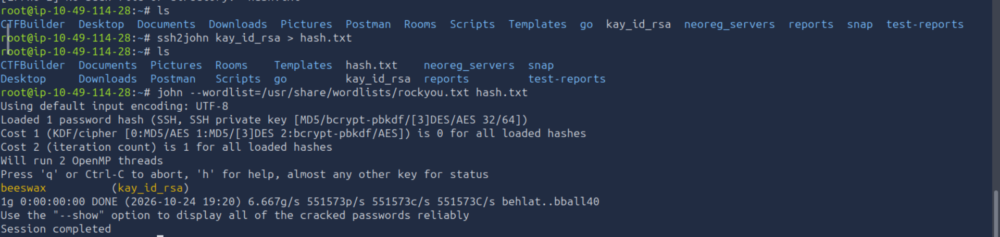
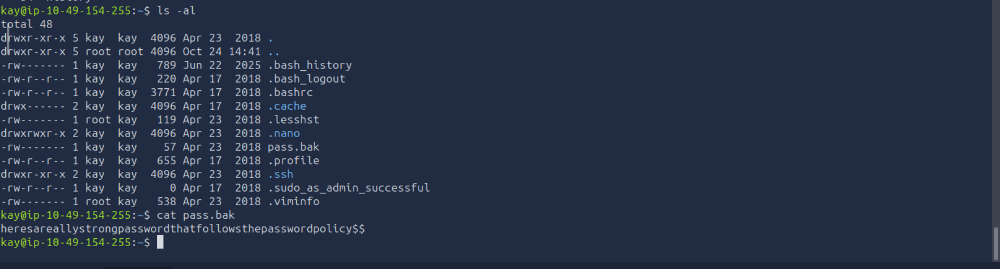

# Penetration Testing Assessment Report
**Target System:** TryHackMe - Basic Pentesting 
**Date:** October 18, 2026 

---

## 1. Executive Summary

### 1.1 Assessment Overview
This report details the security assessment performed against the **Basic Pentesting** target system. The primary goal was to identify exploitable vulnerabilities from an external perspective, gain a low-privilege foothold, and attempt full system administrative compromise (Root).

### 1.2 Summary of Findings
The target system exhibited significant security deficiencies across network services, credential management, and internal file permissions. Full control of the host (**root access**) was successfully achieved via a multi-stage attack chain.

| Metric | Details |
| :--- | :--- |
| **Initial Foothold Vector** | SSH Brute-Force (Weak User Credentials) |
| **Privilege Escalation Vector** | Insecure Private Key Exposure & Weak Passphrase |
| **Max Privilege Achieved** | `root` (Complete System Compromise) |
| **Overall Risk Rating** |  **HIGH** |

---

## 2. Vulnerability Breakdown & Risk Matrix

The table below outlines the specific vulnerabilities discovered, mapped by severity.

| Risk Level | Vulnerability Description | CVE / Reference | Status |
| :--- | :--- | :--- | :--- |
|  **High** | Weak/Default Credentials on SSH Service | CWE-521 | Exploited |
|  **Medium** | Information Disclosure via Web Directories | CWE-538 | Exploited |
|  **Medium** | Insecure File Permissions (Exposed SSH Private Key) | CWE-732 | Exploited |
|  **Low** | SMB Null Session / User Enumeration Allowed | CWE-16 | Exploited |

---

## 3. Technical Walkthrough & Evidence

### 3.1 Phase 1: Enumeration & Reconnaissance

#### Network Scan

```bash
 nmap -sV -A <TARGET_IP>
```

An initial port scan using `Nmap` identified three active services on the perimeter:
* **Port 22/tcp:** OpenSSH 7.2p2 Ubuntu 4ubuntu2.4
* **Port 80/tcp:** Apache httpd 2.4.18
* **Port 445/tcp:** Samba (SMB)


#### Information Leakage (Web)

```bash
 gobuster dir -u http://<TARGET_IP> -w /usr/share/wordlists/dirb/common.txt
```


Directory busting using `Gobuster` revealed an unindexed directory: `/development/`. 
Inside, two text files (`dev.txt` and `j.txt`) were publicly accessible.


Content review indicated:
1. The system administrators used weak passwords.
2. Two users existed on the system with the initials `J` and `K`.

#### User Enumeration (SMB

Use enum4linux to gather information from Windows and Samba (Server Message Block) hosts by running it from the command line against a target IP address

```bash
 enum4linux -R 500 <TARGET_IP>
```


Using `enum4linux` to query the Samba service, the exact local system usernames were extracted:
* `jan`
* `kay`

### 3.2 Phase 2: Initial Foothold (Exploitation)

#### Service Brute-Force
Leveraging the discovered username `jan` and the context that passwords were weak, a dictionary attack was launched against the SSH service using `Hydra` and the `rockyou.txt` wordlist

```bash
 hydra -l jan -P /usr/share/wordlists/rockyou.txt ssh://<TARGET_IP> -t 4
```


* **Result:** **SUCCESS**
* **Command Output:** `[22][ssh] host: <TARGET_IP>   login: jan   password: [PASSWORD]`

A low-privilege interactive terminal session was successfully established as `jan`.

### 3.3 Phase 3: Privilege Escalation

#### Internal Reconnaissance & Horizontal Escalation
During local system profiling, the home directory of the second user, `kay`, was examined. Due to overly permissive access controls, user `jan` was able to read `kay`'s private configuration files.

```bash
 cat /home/kay/.ssh/id_rsa
```

An encrypted private SSH key (`id_rsa`) was recovered from `/home/kay/.ssh/id_rsa`.

#### Passphrase Cracking
The encrypted key was copied to the local attacking machine, and cracked via `John the Ripper`.


  
Through the exploration, discovered .ssh within the directory, and after gaining access to the folder, identified three main highly valuable files that will aid in gaining access to Kay’s account.

a) authorized_key — A list of permitted public keys for servers is kept here. When a client connects to a server, the server verifies the client’s identity by checking the client’s signed public key, which is saved in this file.
b) id_rsa — It’s a personal key, one that should be kept private at all times. (only you can use it, treat it as your own signature)
c) id_rsa.pub — Can distribute it so that others may confirm that a signature came from your private key. (It’s being used to double-check your signature.)


```bash
ssh2john kay_id_rsa > hash.txt
```

The ssh2john tool is a specialized utility used to extract the cryptographic password hash from an encrypted SSH private key so that it can be cracked using the password auditing tool, John the Ripper.

*** Result ***




```bash
 ssh -i kay_id_rsa kay@<TARGET_IP>
```

The -i flag in the ssh command stands for identity file. It tells the SSH client to use a specific private key for authentication instead of attempting to use the default keys stored in your system


* **Result:** Passphrase successfully recovered.
* **Impact:** Horizontal escalation achieved. Logged into SSH directly as `kay`.




## 4. Comprehensive Remediation Roadmap

To secure the asset against future malicious attacks, the following defensive actions are recommended:

* **[Immediate] Enforce Robust Password Complexity:** Enforce an account policy requiring strong, unique multi-character passwords to completely eliminate the risk of automated SSH brute-forcing.
* **[Immediate] Audit File Permissions:** Correct file access control lists (ACLs) across all home directories. Users must not have read or write access to other users' private `.ssh` directories.
* **[Recommended] Hardening SSH Infrastructure:** Disable password-based authentication inside `/etc/ssh/sshd_config`, enforcing public-key-only access.
* **[Recommended] Secure Web Assets:** Remove internal developmental text documents (`.txt` files) from publicly facing directory structures on the Apache server.
