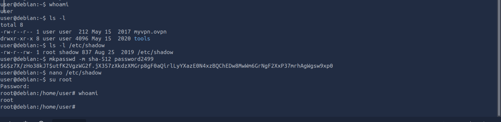

# Linux Privilege Escalation — Technical Report

## 1. Lab Overview

- Platform: TryHackMe
- Room: Linux PrivEsc
- Category: Linux Security / Privilege Escalation
- Status: In Progress

## 2. Objectives

- Enumerate the target Linux system.
- Identify users, groups, system information, and permissions.
- Investigate potential privilege-escalation paths.
- Document evidence and recommend remediation.

## 3. Scope and Environment

Testing is limited to the authorized TryHackMe lab machine.

## 4. Tools Used

a) ssh for remote login to the lab
b) mysql
c)

## 5. Methodology and Findings

### 5.1 Initial Access and Connection

I ssh the user with the command:

```bash
 ssh user@<TARGET_IP>
```

and i was able to login as user with low privileges.

### Privilege escalation by weak file permissions i.e Readable /etc/shadow

The /etc/shadow file contains user password hashes and is usually readable only by the root user.

```bash
 ls -l /etc/shadow
```
I edited the /etc/shadow file and replaced the original root user's password hash with the one I just generated, and I managed to successfully escalate my privileges.




### Privilege escalation by weak file permissions i.e Readable /etc/passwd

The /etc/passwd file contains information about user accounts. It is world-readable, but usually only writable by the root user. Historically, the /etc/passwd file contained user password hashes, and some versions of Linux will still allow password hashes to be stored there.

```bash
 ls -l /etc/passwd
```

I generate a new password hash with my password :

```bash
 openssl passwd <my_password>
```
Edit the /etc/passwd file and place the generated password hash between the first and second colon (:) of the root user's row.
I switched to the root user, using the my new password:

```bash
 su root
```


### 5.2 System Enumeration

Record commands executed, their purpose, and relevant output.

### 5.3 Privilege and Permission Assessment

Document permissions and potential misconfigurations discovered.

### 5.4 Validation

Record how each finding was safely validated in the lab.

## 6. Evidence

Screenshots will be stored in the "screenshots/" directory.

## 7. Findings and Remediation

Document each confirmed finding, its impact, and recommended mitigation.

## 8. Lessons Learned

To be completed after the lab.

## 9. Conclusion

To be completed after the lab.

# Disclaimer

This assessment was conducted in an authorized educational environment.
