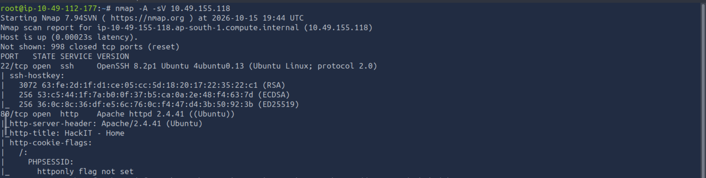
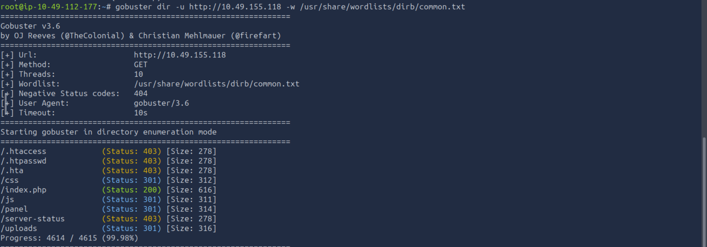
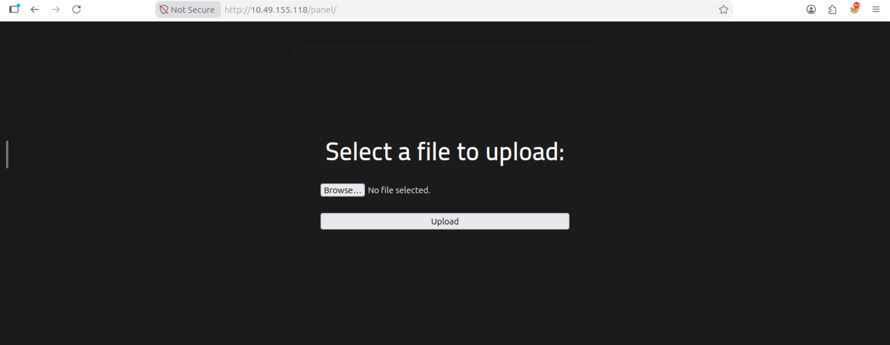

# Rootme penetration testing report

This report was a documentation of rootme lab in TryHackMe.

## Reconnaissance
I did nmap scan of the target to identify the open ports. And I found out that 2 ports were open.
I used the command:

```bash
 nmap -A -sV <TARGET_ip>
````
nmap results:



### Web Directory Enumeration
I used gobuster to identify the directories in the web.

```bash
gobuster dir -u  http://<TARGET_IP> -w /usr/share/wordlists/dirb/common.txt
```



The results shows directories and files like: 
a) /panel (status 301)- a redirect folder. An admin panel is a common entry point for uploading maliciuos files like reverse shell to gain access to the machine.

b) /uploads (status 301)- a redirect likely where files uploaded through /panel page are stored on the server.

c) /index.php( status 200 ) - means success. This is simply the main home page of the website.

d) /css and /js (status 301) - standard directories containing styling and JavaScript code for website's appearance.

e) /.htaccess and /.htpasswd (status 403) - "Forbidden", The server knows these files exist but is blocking you from viewing them. They typically contain configuration settings and login credentials.




